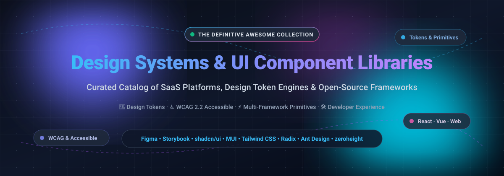

# 🎨 Awesome Design System & UI Component Library

  

  
  
  
  
  
  

---

## 🌟 Top Design System & UI Component Library
**A Curated List of SaaS Products, Design Token Platforms & Open-Source GitHub Repositories**

*Focused on Production-Ready Design Systems, UI Component Libraries, W3C Design Tokens & WCAG Accessible Interface Patterns.*

> 💡 **Search Keywords / SEO**: design systems, UI component library, react components, design tokens, headless UI, accessibility, WCAG 2.2, tailwind components, storybook, figma tokens, design ops, front-end architecture, UI kits.

---

## 📑 Table of Contents
- [📊 Sector Overview & Market Dynamics](#-sector-overview--market-dynamics)
- [☁️ SaaS & Hosted Design System Platforms](#️-saas--hosted-design-system-platforms)
- [🏢 Enterprise & Product Design Systems](#-enterprise--product-design-systems)
- [🚀 Open-Source GitHub Projects](#-open-source-github-projects)
- [🛠️ Architecture & Custom Implementation Guide](#️-architecture--custom-implementation-guide)
- [🤝 How to Contribute](#-how-to-contribute)
- [💖 Support & Sponsorship](#-support--sponsorship)
- [📈 Star History](#-star-history)
- [⚖️ Disclaimer](#️-disclaimer)

---

## 📊 Sector Overview & Market Dynamics

The standalone **Design Systems & UI Engineering Software** market is currently estimated at approximately **$350M–$390M in direct software spend**, projected to reach over **$870M by 2035** at a compound annual growth rate (CAGR) of ~9.5%, while anchoring a broader multi-billion dollar UI/UX and front-end development tooling economy. 

Market dynamics exhibit **extreme concentration at the canvas layer** (where Figma commands near-monopoly dominance following a winner-take-most dynamic in collaborative UI design) coupled with **moderate fragmentation in the downstream documentation, token pipeline, and component layer** (where specialized players like zeroheight, Chromatic, Supernova, and Tokens Studio compete alongside community-driven headless open-source stacks).

---

## ☁️ SaaS & Hosted Design System Platforms

*The table below catalogs commercial SaaS platforms for design token orchestration, visual regression testing, component workshops, and documentation styleguides, sorted descending by scale (market capitalization, valuation, or ARR).*

| Product | Company Scale (Valuation / ARR) | Description | Pricing (Starting Tier) | Free Tier Limits |
| :--- | :--- | :--- | :--- | :--- |
| **[Figma](https://www.figma.com/)** | **~$19B–$25B Valuation** / $1.05B+ ARR (Public: FIG) | Industry-standard collaborative interface design, design system token/component, and prototyping platform. | $15 / editor / month (Professional billed annually) or $18 / month ($12 / month for Dev Mode seat) | Free forever (Starter): 3 shared Figma Design/Sites files, 3 FigJam files, 30-day version history, unlimited personal drafts, and 150 AI credits/day. |
| **[Tailwind UI](https://tailwindui.com/)** | **Acquired by Shopify** (Shopify: ~$110B+ Market Cap) | Premium application, marketing, and ecommerce component collection and templates built with Tailwind CSS. | $299 one-time purchase for lifetime individual access (legacy all-access; direct new purchases currently paused) | Free preview tier: Lifetime free access to select sample interactive component previews and free open-source primitives via Headless UI. |
| **[zeroheight](https://zeroheight.com/)** | **~$50M–$100M Valuation** / ~$3.8M ARR ($10.8M raised) | Cloud documentation hub connecting Figma tokens and code into interactive styleguides. | $49 / editor / month (billed annually) or $59 / month | Free forever: 1 editor, 1 styleguide, 1 token set, unlimited viewers, basic AI assistant, 500 MCP calls/month. |
| **[Chromatic](https://www.chromatic.com/)** | **~$40M–$75M Est. Valuation** / ~$3.4M ARR ($10.5M raised) | Cloud visual regression testing and UI review platform for Storybook and component libraries. | $179 / month (Starter plan for 35,000 snapshots) | Free forever: Up to 5,000 billed snapshots/month (Chrome only), unlimited projects, users, and collaborators (testing pauses when cap is reached). |
| **[Supernova](https://supernova.io/)** | **~$20M–$35M Est. Valuation** (~$9.2M venture raised) | End-to-end design system platform bridging design tokens, documentation, and code generation. | $399 / month (Pro plan) | Free forever (Starter): Up to 3 editors, up to 20 documentation pages (public access only), 1,000 workspace credits/month, 1 MCP server, up to 10 AI skills. |
| **[Specify](https://specifyapp.com/)** | **~$15M–$25M Est. Valuation** (~€4.1M seed raised) | Design token automation and distribution engine connecting Figma to code repositories via automated PRs. | $20 / month (Specify App Pro) / $69 / month (Essentials token repository) | 14-day free trial on paid plans (full access during trial); Free tier available for personal docs with 100MB storage and basic AI usage. |
| **[Tokens Studio](https://tokens.studio/)** | **Bootstrapped / High-Growth SaaS** | Centralized design token management platform and Figma plugin with Git sync pipelines. | €39 / user / month (Team plan billed annually) | Free forever: 1 editor seat, unlimited viewers, 1 project with 1 active branch, 1 theme group with 2 theme options, 1 export configuration (excludes paid Figma plugin sync features). |

---

## 🏢 Enterprise & Product Design Systems

*Notable battle-tested design systems maintained by tech leaders, offering rich design guidelines, token specs, accessibility blueprints, and code implementations.*

| Design System | Organization | Description | Availability & Pricing |
| :--- | :--- | :--- | :--- |
| **[Google Material Design](https://m3.material.io/)** | Google | Comprehensive design system (Material 3) with guidelines, tokens, and multi-platform kits. | 100% Free & open source (Android, Web, Flutter, React via MUI). |
| **[Adobe Spectrum](https://spectrum.adobe.com/)** | Adobe | Guidelines, design tokens, and components used across Adobe products. | Free & open-source implementations (React Spectrum, Spectrum Web Components). |
| **[Salesforce Lightning Design System](https://www.lightningdesignsystem.com/)** | Salesforce | Component blueprints, design tokens, and guidelines powering Salesforce enterprise experiences. | Free & open source (blueprints, tokens, styling hooks, and React wrappers). |
| **[Microsoft Fluent Design System](https://fluent2.microsoft.design/)** | Microsoft | Design language and system across Windows, Office, and Microsoft 365. | Free & open source (Fluent UI for React and Web Components). |
| **[Shopify Polaris](https://polaris.shopify.com/)** | Shopify | Design system powering merchant administration and merchant-facing apps. | Free & open source (Polaris React component library on GitHub). |
| **[IBM Carbon Design System](https://carbondesignsystem.com/)** | IBM | Enterprise design system with comprehensive component implementations across frameworks. | 100% Free & open source (React, Web Components, Angular, Vue). |
| **[Atlassian Design System](https://atlassian.design/)** | Atlassian | Foundations, tokens, and components used across Jira, Confluence, and Atlassian tools. | Free public access to guidelines, design tokens, and Figma kits. |
| **[GitHub Primer](https://primer.style/)** | GitHub | Foundational design system powering GitHub's web products and developer tools. | 100% Free & open source (React, ViewComponent, CSS, design tokens). |
| **[Ant Design](https://ant.design/)** | Ant Group | Enterprise-class UI design language and extensive React component suite. | 100% Free & open source (MIT license, also offers commercial MUI/Ant templates). |

---

## 🚀 Open-Source GitHub Projects

*Leading open-source UI libraries, headless primitives, component frameworks, and workshop tools. Sorted descending by GitHub stargazers count.*

| Repository | GitHub_Stars | Core Focus / Description |
| :--- | :--- | :--- |
| **[shadcn/ui](https://github.com/shadcn-ui/ui)** |  | Beautifully designed, accessible components built with Radix UI and Tailwind CSS. Copy-paste architecture with full source code ownership. |
| **[ant-design/ant-design](https://github.com/ant-design/ant-design)** |  | Enterprise-class UI design language and React component library with internationalization, theming, and rich data tables. |
| **[mui/material-ui](https://github.com/mui/material-ui)** |  | The most widely used React UI library implementing Google's Material Design with customizable styles and deep token support. |
| **[tailwindlabs/tailwindcss](https://github.com/tailwindlabs/tailwindcss)** |  | The leading utility-first CSS framework for rapid UI development and styling custom design tokens. |
| **[storybookjs/storybook](https://github.com/storybookjs/storybook)** |  | The industry-standard frontend workshop for building, isolating, testing, and documenting UI components. |
| **[chakra-ui/chakra-ui](https://github.com/chakra-ui/chakra-ui)** |  | Simple, modular, and accessible component library giving you building blocks for React applications with style props. |
| **[mantinedev/mantine](https://github.com/mantinedev/mantine)** |  | Comprehensive React component library featuring 100+ customizable hooks and components with dark theme support. |
| **[nextui-org/nextui](https://github.com/nextui-org/nextui)** |  | Beautiful, fast, and modern React UI library built on Tailwind CSS and React Aria (rebranding to HeroUI). |
| **[tailwindlabs/headlessui](https://github.com/tailwindlabs/headlessui)** |  | Completely unstyled, fully accessible UI components for React and Vue, designed to integrate with Tailwind CSS. |
| **[lucide-icons/lucide](https://github.com/lucide-icons/lucide)** |  | Beautiful and consistent icon toolkit for design systems, supporting React, Vue, Svelte, and Web Components. |
| **[tabler/tabler-icons](https://github.com/tabler/tabler-icons)** |  | Over 5,200 pixel-perfect, open-source SVG icons designed for modern user interfaces and dashboards. |
| **[microsoft/fluentui](https://github.com/microsoft/fluentui)** |  | Microsoft's official cross-platform UI framework (React and Web Components) implementing the Fluent Design System. |
| **[radix-ui/primitives](https://github.com/radix-ui/primitives)** |  | Unstyled, accessible React components and primitives for building high-quality design systems and apps. |
| **[adobe/react-spectrum](https://github.com/adobe/react-spectrum)** |  | Adobe's collection of libraries (React Aria, React Stately, React Spectrum) delivering accessible UI primitives. |
| **[carbon-design-system/carbon](https://github.com/carbon-design-system/carbon)** |  | IBM's open-source design system with accessible components across React, Web Components, Angular, and Vue. |
| **[ariakit/ariakit](https://github.com/ariakit/ariakit)** |  | Toolkit for building accessible web applications, design systems, and unstyled component libraries. |
| **[Shopify/polaris](https://github.com/Shopify/polaris)** |  | Shopify's design system React components for building consistent, accessible merchant experiences. |
| **[chakra-ui/ark](https://github.com/chakra-ui/ark)** |  | Universal headless UI component library powered by state machines, supporting React, Vue, and Solid. |
| **[primer/react](https://github.com/primer/react)** |  | GitHub's React implementation of the Primer design system, powering GitHub's web interfaces. |

---

## 🛠️ Architecture & Custom Implementation Guide

When engineering custom enterprise design systems from scratch:
1. **Accessibility Foundation**: Start with battle-tested primitives like **Radix UI**, **React Aria**, or **Ark UI** to inherit full keyboard navigation and ARIA compliance.
2. **Design Tokens & Styling**: Manage design tokens with tools like **Tokens Studio** or **Specify**, mapping them to utility CSS via **Tailwind CSS** or CSS variables.
3. **Component Implementation**: Assemble reusable components following patterns from **shadcn/ui**, **MUI**, or **Carbon**.
4. **Testing & Isolation**: Build and document components in **Storybook**, validating visuals and interactions in CI/CD with **Chromatic**.
5. **Documentation Portal**: Publish styleguides and component guidelines to **zeroheight** or **Supernova** for cross-functional alignment.

---

## 🤝 How to Contribute
1. 🍴 Fork the repository.
2. 📝 Add or edit entries in `README.md` adhering to the tabular format and objective descriptions.
3. ⭐ Ensure links to documentation and official repositories are correct.
4. 🚀 Submit a Pull Request with a clear explanation of your additions.

---

## 💖 Support & Sponsorship

Thank you for exploring and supporting **Awesome Design System & UI Component Library**! 🎉

If you find this curated collection helpful for your projects, design team, or engineering organization, please consider supporting the project:
* ⭐ **Star this repository** to help others discover it.
* 🍴 **Fork and contribute** to keep the resources up to date.
* 📢 **Share** with your colleagues, design community, and front-end teams.
* ☕ **Buy me a coffee / Sponsor the project**: Support ongoing maintenance via the [GitHub Sponsor Dashboard](https://github.com/sponsors/ishandutta2007).

Your backing ensures these resources remain updated, comprehensive, and high-quality!

---

## 📈 Star History

---

## ⚖️ Disclaimer
- This is an independent, **community-curated** catalog — not an official endorsement.
- All trademarks, logos, and brand names are property of their respective owners.
- Design systems and component libraries should be independently vetted for licensing, WCAG accessibility, and framework compatibility before enterprise deployment.
